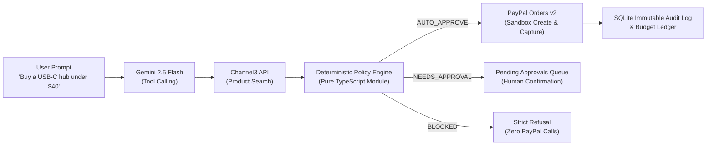

# SpendGuard 🛡️

> **PayPal AI Hackathon (Devpost)**  
> **Core Principle:** *The LLM proposes, deterministic code decides.*  
> **Live Demo / Repo:** [https://github.com/ritesh-1912/SpendGuard-Paypal-Hackathon-.git](https://github.com/ritesh-1912/SpendGuard-Paypal-Hackathon-.git)  
> **License:** Open Source ([MIT](LICENSE))

---

## What is SpendGuard?

Autonomous AI shopping agents promise to find and buy things for us, but users cannot safely hand an LLM an open credit card. Prompt injection, hallucinated prices, and runaway agent loops create unacceptable financial risk.

**SpendGuard solves this with an uncompromising architectural boundary:**
1. **The LLM proposes:** Gemini parses rules in plain English and uses tool calling to search product catalogs.
2. **Deterministic code decides:** A pure, zero-network policy engine approves, blocks, or escalates every purchase proposal before a single cent is touched.
3. **PayPal executes:** Only validated or human-approved purchases generate PayPal Orders v2 sandbox sessions.



---

## PayPal APIs and AI Tools Used

### 1. PayPal REST APIs (Sandbox)
SpendGuard uses the official PayPal REST API server-side:
- **Orders v2 (`POST /v2/checkout/orders`)**: Created with `intent: "CAPTURE"`, item metadata, and an explicit `return_url`. The server generates an active PayPal order and provides the buyer approval link.
- **Order Capture (`POST /v2/checkout/orders/{id}/capture`)**: Triggered immediately upon buyer approval in the PayPal sandbox popup/redirect. Captures the payment, extracts the PayPal Capture ID, and updates the local budget ledger.
- **OAuth 2.0 Client Credentials (`POST /v1/oauth2/token`)**: Server-to-server token generation with in-memory caching and automatic refresh. Secrets are kept strictly in `.env` and never logged.
- **Payments v2 Refunds (`POST /v2/payments/captures/{id}/refund`)**: Allows instantaneous policy reversals and returns funds to the SpendGuard monthly budget ledger.
- **Webhooks & Signature Verification (`POST /v1/notifications/verify-webhook-signature`)**: Listens for `PAYMENT.CAPTURE.COMPLETED` and `PAYMENT.CAPTURE.REFUNDED` events to asynchronously sync payment state and verify webhook signatures.

### 2. Google Gemini 2.5 Flash
SpendGuard leverages Gemini across two separate, constrained roles:
- **Structured Output Policy Parser (`lib/policy/parser.ts`)**:
  - Uses `responseMimeType: "application/json"` and strict `responseSchema`.
  - Compiles plain-language rules (e.g., *"Max $150/month, electronics and books only, ask me before anything over $40, hard limit $100 per item, no Temu"*) into a structured, validated `Policy` object.
  - **Confirmation Safety Gate**: The compiled JSON is presented side-by-side to the user for explicit confirmation before saving to SQLite.
- **Conversational Agent Loop with Function Calling (`lib/agent/coordinator.ts`)**:
  - Equips Gemini with discovery tools (`searchProducts`, `getBudgetSummary`).
  - **Crucial Security Boundary**: The agent has **ZERO** direct tools or credentials to call PayPal. The LLM can only recommend products; all proposals are intercepted by the deterministic policy engine.

---

## 🚀 Judge Quickstart (Local Run in Under 10 Minutes)

### Prerequisites
- **Node.js**: `v22.5.0` or higher (tested on Node v22 and v24 with native `node:sqlite`)
- **npm**: `v10.0.0` or higher

### Step 1: Clone & Install Dependencies
```bash
git clone https://github.com/ritesh-1912/SpendGuard-Paypal-Hackathon-.git
cd SpendGuard-Paypal-Hackathon-
npm install
```

### Step 2: Configure Environment Variables
Copy the template file to `.env`:
```bash
cp .env.example .env
```

Open `.env` in your editor. You can test in either of two modes:

#### Option A: Real PayPal Sandbox Mode (Recommended)
Add your sandbox credentials from [developer.paypal.com/dashboard/applications/sandbox](https://developer.paypal.com/dashboard/applications/sandbox):
```bash
NEXT_PUBLIC_APP_URL="http://localhost:3000"
PAYPAL_ENVIRONMENT="sandbox"
PAYPAL_CLIENT_ID="<your_sandbox_client_id>"
PAYPAL_CLIENT_SECRET="<your_sandbox_client_secret>"
PAYPAL_WEBHOOK_ID=""

# Optional: Gemini API Key (offline fallback parser will run if empty)
GEMINI_API_KEY="<your_gemini_api_key>"
GEMINI_MODEL="gemini-2.5-flash"

# Optional: Channel3 API Key (offline curated catalog runs if empty)
CHANNEL3_API_KEY=""

DATABASE_PATH="./data/spendguard.db"
MOCK_PAYPAL_CAPTURE="false"
```

#### Option B: Offline Judge Demo Mode (Instant, No Keys Required)
To run the full end-to-end demo flow without entering sandbox keys:
```bash
MOCK_PAYPAL_CAPTURE="true"
```

### Step 3: Run the Deterministic Policy Engine Test Suite
Run the 25 automated unit tests covering all boundary conditions in `docs/TEST_PLAN.md`:
```bash
npm test
```
*Expected Result: 25 passing tests in <200ms.*

### Step 4: Start the Development Server
```bash
npm run dev
```
Open **[http://localhost:3000](http://localhost:3000)** in your browser.

---

## 🧪 PayPal Sandbox Test Credentials

When testing live sandbox checkouts, use a PayPal Sandbox Personal (Buyer) account created in your [PayPal Developer Dashboard](https://developer.paypal.com/dashboard/accounts):

| Field | Sandbox Test Value |
| :--- | :--- |
| **Buyer Email** | `buyer-spendguard@personal.example.com` *(or your sandbox personal account)* |
| **Password** | Your sandbox account password |
| **Environment** | PayPal Sandbox (`api-m.sandbox.paypal.com`) |

---

## 🎬 Step-by-Step Demo Walkthrough (For Judges)

Follow this 4-minute walkthrough to verify every capability:

### Scenario 1: Side-by-Side Policy Studio & Confirmation (1 Minute)
1. In the top navigation, click **"Policy Studio"**.
2. Notice the side-by-side view:
   - **Left**: Plain language rules editor.
   - **Right**: Real-time compiled JSON schema.
3. Select the preset **"Strict Tech ($150)"** or type:
   > *"Max $150/month, electronics and books only, ask me before anything over $40, hard limit $100 per item, no Temu or AliExpress."*
4. Click **"Compile to Structured JSON"**.
5. Observe the verified JSON schema on the right (Cap: $150, Ask Above: $40, Hard Ceiling: $100, Allowed: electronics, books).
6. Click **"Confirm & Activate Policy"**.
7. **Verify**: Top banner immediately updates to show the active enforced rules.

### Scenario 2: Auto-Approved Purchase (`AUTO_APPROVE`) (1 Minute)
1. Switch to the **"Agent Chat"** tab.
2. Click the quick prompt pill: **"⚡ USB-C Hub ($39.99 Auto-Approve)"** (or type *"Buy a multiport USB-C hub under $40"*).
3. Observe:
   - Agent invokes `searchProducts` tool and recommends the **8-in-1 USB-C Hub ($39.99)**.
   - **Approval Card Renders**:
     - Badge: **`AUTO_APPROVE`** (Green)
     - Rule Fired: `RULE_AUTO_APPROVE_CRITERIA_MET`
     - Reason: *"Price ($39.99) is within auto-approval threshold ($40.00) and monthly budget ($150.00)."*
4. Click **"Create PayPal Sandbox Order ($39.99)"**.
5. Click **"Pay with PayPal Sandbox"** $\rightarrow$ Logs into PayPal Sandbox $\rightarrow$ click **"Complete Purchase"**.
6. PayPal redirects back to SpendGuard `/checkout/success` $\rightarrow$ payment captures synchronously.
7. Click **"Return to Dashboard"** $\rightarrow$ Observe:
   - Budget counter updates dynamically: **$18.99 $\rightarrow$ $58.98 spent / $150 limit**.
   - Progress bar updates with category breakdown.

### Scenario 3: Escalated Purchase Requiring Human Approval (`NEEDS_APPROVAL`) (1 Minute)
1. In the **"Agent Chat"** tab, click **"⚠️ Keyboard ($64.99 Needs-Approval)"**.
2. Observe:
   - Agent proposes the Mechanical Keyboard ($64.99).
   - Policy Engine returns: **`NEEDS_APPROVAL`** (Amber)
   - Rule Fired: `RULE_THRESHOLD_EXCEEDED`
   - Reason: *"Price ($64.99) exceeds auto-approval threshold of $40.00. Human confirmation required."*
3. Notice PayPal is **not** called automatically.
4. Click the **"Dashboard"** tab $\rightarrow$ Notice the **Pending Approvals Queue** badge has **1 Waiting**.
5. Review the flagged item in the queue and click **"Approve & Pay ($64.99)"**.
6. A PayPal sandbox checkout session generates immediately upon your human approval.

### Scenario 4: Deterministically Blocked Purchase (`BLOCKED`) (30 Seconds)
1. In the **"Agent Chat"** tab, ask:
   > *"Buy lightweight running shoes for $50"*
2. Observe:
   - Agent discovers shoes in category `apparel`.
   - Policy Engine returns: **`BLOCKED BY POLICY`** (Red)
   - Rule Fired: `RULE_CATEGORY_BLOCKED`
   - Reason: *"Category 'apparel' is explicitly blacklisted."*
3. **Zero Financial Impact**: PayPal button is strictly locked. Zero orders or network calls to PayPal are permitted.

### Scenario 5: Searchable Immutable Audit Trail (30 Seconds)
1. Click the **"Audit Trail"** tab.
2. Review the chronological record of events: `RULE_PARSED`, `POLICY_CONFIRMED`, `AGENT_PROPOSAL`, `PAYPAL_ORDER_CREATED`, `PAYPAL_ORDER_CAPTURED`.
3. Click any row to expand the **JSON Payload Inspector**, showing internal order IDs, PayPal capture IDs, and exact rule attribution.
4. Test the real-time search filter by typing `"CAPTURE"` or `"RULE_THRESHOLD_EXCEEDED"`.

---

## ☁️ Render Deployment & Webhooks

### Render Configuration (`render.yaml`)
A complete `render.yaml` blueprint is included in the root directory:
- **Runtime:** Node.js
- **Build Command:** `npm install && npm run build`
- **Start Command:** `npm start`
- **Port:** Configured via `PORT` (defaults to 3000)

### Note on SQLite Ephemeral Storage & Automatic Seeding
Render's free tier uses an ephemeral filesystem that resets on container redeployment.  
**SpendGuard handles this gracefully:**
- On container cold-start, `lib/db/index.ts` automatically executes `seedDemoData()`.
- The database is instantly populated with the default active policy, budget ledger, sample past transactions, and initial audit logs.
- You can manually re-seed at any time with:
  ```bash
  npm run seed
  ```

### PayPal Webhook Setup for Deployed URL
1. Log in to [developer.paypal.com](https://developer.paypal.com) $\rightarrow$ **Sandbox Apps & Credentials** $\rightarrow$ select your App.
2. Click **Add Webhook**.
3. Set the Webhook URL to:
   ```
   https://<your-render-app-url>.onrender.com/api/webhooks/paypal
   ```
4. Subscribe to the following events:
   - `PAYMENT.CAPTURE.COMPLETED`
   - `PAYMENT.CAPTURE.REFUNDED`
   - `CHECKOUT.ORDER.APPROVED`
5. Copy the generated **Webhook ID** and set it in your Render Environment Variables as `PAYPAL_WEBHOOK_ID`.
6. Incoming webhooks are cryptographically validated server-side using PayPal's `POST /v1/notifications/verify-webhook-signature` endpoint.

---

## 🔒 Security & Hackathon Rules Compliance

- **No Secrets in Repo:** Verified with `git log -p`. All credentials (`PAYPAL_CLIENT_SECRET`, `GEMINI_API_KEY`) reside exclusively in `.env` (git-ignored) and are masked in all audit payloads.
- **Open-Source License:** Licensed under the permissive [MIT License](LICENSE).
- **Zero Mockups:** The app runs end-to-end with real SQLite transactions, live PayPal Orders v2 sandbox checkout, and live Gemini function calling.
- **Trademark Free:** Clean SVG iconography is used in place of third-party retail logos for demo video recording.

---

## Technical Stack Summary

| Layer | Technology |
| :--- | :--- |
| **Framework** | Next.js 15.5 (App Router), React 19, TypeScript |
| **Styling** | Tailwind CSS, Lucide React Icons |
| **Database** | SQLite via native `node:sqlite` (zero compilation dependencies) |
| **AI / LLM** | Google Gemini 2.5 Flash (`@google/genai`) with Structured Outputs & Function Calling |
| **Payments** | PayPal REST API (Orders v2 Sandbox, Payments v2, OAuth2, Webhooks) |
| **Catalog** | Channel3 Search API (`https://api.trychannel3.com/v1`) with offline catalog fallback |
| **Deployment** | Render (`render.yaml`) |

---

*Built with precision for the PayPal AI Hackathon.*
