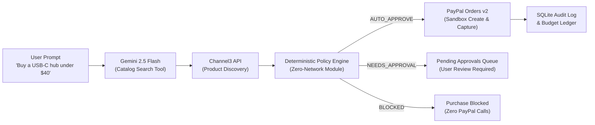

# SpendGuard

> **PayPal AI Hackathon (Devpost)**  
> **Core Principle:** *The LLM proposes, deterministic code decides.*  
> **Live Application:** [https://spendguard-paypal-hackathon.onrender.com](https://spendguard-paypal-hackathon.onrender.com)  
> **Repository:** [https://github.com/ritesh-1912/SpendGuard-Paypal-Hackathon](https://github.com/ritesh-1912/SpendGuard-Paypal-Hackathon)  
> **License:** [MIT](LICENSE)

> [!IMPORTANT]
> **Evaluation Recommendation for Judges:**  
> Please test SpendGuard directly on the live hosted deployment at **[https://spendguard-paypal-hackathon.onrender.com](https://spendguard-paypal-hackathon.onrender.com)**.  
> It is connected to live Channel3 merchant product discovery, PayPal Orders v2 sandbox checkout, public PayPal webhooks with cryptographic signature verification, and Google Gemini.

---

## Overview

Autonomous AI shopping agents can discover products and draft purchase proposals, but giving an LLM direct access to credit cards or checkout credentials introduces severe financial risk. Prompt injection, non-deterministic reasoning, and unconstrained tool execution can result in unintended purchases or budget depletion.

SpendGuard implements a strict architectural boundary:
1. **The LLM proposes:** Gemini parses user-defined spending rules and queries product catalogs.
2. **Deterministic code decides:** A pure TypeScript policy engine with zero network access evaluates every purchase proposal against the user's spending limits.
3. **PayPal executes:** Only approved purchases create PayPal Orders v2 sandbox sessions. The agent holds no credentials and cannot initiate checkout directly.



---

## Architectural Decision: Model Proposes, Deterministic Code Decides

In SpendGuard, the AI model never holds authorization to spend money. The separation of responsibilities is enforced at the code level:

- **Why the LLM is restricted to proposing:** Large language models excel at semantic interpretation—understanding natural language instructions, mapping categories, and parsing user intents. However, LLMs are fundamentally probabilistic and susceptible to prompt injection, hallucinated parameters, and out-of-order execution. Giving an LLM direct tool access to payment endpoints creates an uncontained failure surface.
- **Why deterministic code decides:** Financial policies require mathematical certainty. A monthly budget ceiling, a per-item price cap, merchant blacklists, and duplicate purchase windows must evaluate identically every time, without model drift or nondeterminism. In SpendGuard, policy evaluation runs in a standalone, synchronous TypeScript module (`lib/policy/engine.ts`) with no network access and no external dependencies.
- **The safety boundary:** The agent loop (`lib/agent/coordinator.ts`) exposes only discovery tools (`searchProducts`, `getBudgetSummary`). It cannot call PayPal. Every proposal returned by the agent must pass through the deterministic policy engine before any PayPal order creation API is invoked.

---

## PayPal APIs and AI Tools Used

### 1. PayPal REST APIs (Sandbox)
- **Orders v2 (`POST /v2/checkout/orders`)**: Created with `intent: "CAPTURE"`, purchase unit details, and a return URL. Returns the buyer approval link.
- **Order Capture (`POST /v2/checkout/orders/{id}/capture`)**: Captures authorized funds upon buyer return, saves the capture ID, and updates the SQLite budget ledger.
- **OAuth 2.0 Client Credentials (`POST /v1/oauth2/token`)**: Server-side authentication with token caching and refresh. Secrets remain server-side in `.env` and are never exposed to the client.
- **Webhooks & Signature Verification (`POST /v1/notifications/verify-webhook-signature`)**: Handles `CHECKOUT.ORDER.APPROVED` and `PAYMENT.CAPTURE.COMPLETED` events, verifying transmission headers before updating order status.

### 2. Google Gemini
- **Structured Output Policy Parser (`lib/policy/parser.ts`)**: Uses `responseMimeType: "application/json"` with a strict JSON schema to convert plain-language rules into structured policy objects. The parsed policy requires explicit user confirmation before becoming active. If Gemini is unavailable, the system visibly reports the fallback parser and reason.
- **Agent Loop with Function Calling (`lib/agent/coordinator.ts`)**: Uses Gemini tool calling to search the Channel3 catalog. Tool responses are evaluated through the policy engine before any PayPal call is made.

---

## Live Hosted App (Recommended for Judging)

Judges can explore the complete live application directly:

**[https://spendguard-paypal-hackathon.onrender.com](https://spendguard-paypal-hackathon.onrender.com)**

The live deployment features:
- Live product discovery from real merchants via Channel3.
- Active policy enforcement with the deterministic engine.
- Live PayPal Sandbox Orders v2 creation and capture.
- Real-time SQLite audit log and budget ledger updates.

---

## Sandbox Buyer Account

To approve transactions during the live walkthrough, use the following PayPal sandbox buyer credentials:

| Field | Value |
| :--- | :--- |
| **Email** | |
| **Password** | |

> [!NOTE]
> This is a PayPal Sandbox personal test account created in the PayPal Developer Dashboard for evaluation. It is not a real financial account and transfers no real currency.

---

## Local Setup (Alternative)

If you prefer to run the application locally on your machine:

### Prerequisites
- **Node.js**: `v22.5.0` or higher (tested on Node v22 and v24 with native `node:sqlite`)
- **npm**: `v10.0.0` or higher

### Step 1: Clone and Install
```bash
git clone https://github.com/ritesh-1912/SpendGuard-Paypal-Hackathon.git
cd SpendGuard-Paypal-Hackathon
npm install
```

### Step 2: Configure Environment Variables
Copy the template file to `.env`:
```bash
cp .env.example .env
```

Configure `.env` with live sandbox credentials:
```bash
APP_URL="http://localhost:3000"
NEXT_PUBLIC_APP_URL="http://localhost:3000"

PAYPAL_ENVIRONMENT="sandbox"
PAYPAL_CLIENT_ID="<your_sandbox_client_id>"
PAYPAL_CLIENT_SECRET="<your_sandbox_client_secret>"
PAYPAL_WEBHOOK_ID=""

GEMINI_API_KEY="<your_gemini_api_key>"
GEMINI_MODEL="gemini-2.5-flash"

CHANNEL3_API_KEY="<your_channel3_api_key>"
CHANNEL3_BASE_URL="https://api.trychannel3.com/v1"

DATABASE_PATH="./data/spendguard.db"
DEMO_OFFLINE="false"
MOCK_PAYPAL_CAPTURE="false"
```

### Step 3: Run the Test Suite
Run the 42 unit tests covering policy rules, startup validation, idempotency, failure cases, health checks, and fallback reporting:
```bash
npm test
```
All 42 tests pass in under 400ms.

### Step 4: Start the Application
```bash
npm run dev
```
Open **[http://localhost:3000](http://localhost:3000)** in your browser.

---

## Development without API Keys (Local Offline Mode)

> [!NOTE]
> This mode is intended exclusively for offline local development without external API keys. It is not used for judging.

To run locally without external credentials:
```bash
DEMO_OFFLINE="true"
MOCK_PAYPAL_CAPTURE="true"
```
In this mode, product queries return curated sample items clearly labeled with a `Sample data` badge, and PayPal captures are simulated without contacting external gateways. Note that `DEMO_OFFLINE=true` is blocked at startup in production (`NODE_ENV=production`) unless explicitly overridden with `ALLOW_OFFLINE_IN_PROD=true`.

---

## Step-by-Step Demo Walkthrough

### 1. Policy Editor & Confirmation
1. In the top navigation, click **Policy**.
2. Notice the side-by-side view: plain-language input on the left, parsed JSON on the right.
3. Select the preset **Strict tech ($150)** or enter:
   > *"Max $150/month, electronics and books only, ask me before anything over $40, hard limit $100 per item, no Temu or AliExpress."*
4. Click **Parse into policy JSON**.
5. Observe the parser label (`Gemini` or `Rules fallback`).
6. Review the structured rules (Monthly cap: $150, Ask above: $40, Ceiling: $100).
7. Click **Confirm and activate policy**.
8. The active policy banner updates immediately.

### 2. Auto-Approved Purchase (`AUTO_APPROVE`)
1. Switch to the **Chat** tab.
2. Click the example pill **USB-C Hub ($38.50 - Auto-approve)** or type:
   > *"Buy a multiport USB-C hub under $40"*
3. The agent searches the live catalog and proposes a matching item.
4. The policy engine evaluates the proposal:
   - Status: `AUTO_APPROVE`
   - Rule fired: `RULE_AUTO_APPROVE_CRITERIA_MET`
   - Reason: Within auto-approval threshold ($40.00) and monthly budget ($150.00).
5. Click **Create PayPal sandbox order**.
6. Click **Pay in PayPal sandbox** to open the PayPal sandbox checkout flow.
7. Log in with your Sandbox Buyer account and approve the payment.
8. PayPal redirects to `/checkout/success`, and the payment is captured.
9. Verify the updated spend and remaining budget on the dashboard.

### 3. Escalated Purchase Requiring Human Approval (`NEEDS_APPROVAL`)
1. In the **Chat** tab, click **Keyboard ($64.20 - Needs approval)**.
2. The agent proposes a Mechanical Keyboard ($64.20).
3. The policy engine evaluates the proposal:
   - Status: `NEEDS_APPROVAL`
   - Rule fired: `RULE_THRESHOLD_EXCEEDED`
   - Reason: Price ($64.20) exceeds auto-approval threshold of $40.00.
4. Switch to the **Dashboard** tab.
5. In the **Pending approvals** queue, review the item and click **Approve & Pay ($64.20)**.
6. A PayPal sandbox order is created only upon manual human approval.

### 4. Blocked Purchase (`BLOCKED`)
1. In the **Chat** tab, click **Running shoes (Blocked category)** or type:
   > *"Buy lightweight running shoes"*
2. The agent discovers shoes in the `apparel` category.
3. The policy engine evaluates the proposal:
   - Status: `BLOCKED BY POLICY`
   - Rule fired: `RULE_CATEGORY_BLOCKED`
   - Reason: Category 'apparel' is not in the allowed categories list.
4. Checkout is disabled. Zero network calls to PayPal are made.

### 5. Audit Log Inspection
1. Click the **Audit log** tab.
2. View chronological records: `RULE_PARSED`, `POLICY_CONFIRMED`, `AGENT_PROPOSAL`, `PAYPAL_ORDER_CREATED`, `PAYPAL_ORDER_CAPTURED`.
3. Click any row to inspect the JSON payload containing internal IDs, PayPal capture IDs, parser attribution, and rule names.
4. Filter events using the search bar (e.g., search `CAPTURE` or `BLOCKED`).

---

## Limitations

- **Sandbox only:** All transactions execute against the PayPal Sandbox environment (`api-m.sandbox.paypal.com`). No real money is transferred.
- **Single demo user:** Authentication is scoped to a single local user session for hackathon evaluation; multi-tenant user authentication is not implemented.
- **Ephemeral storage on Render:** Render free-tier web services use ephemeral disk storage that resets upon container restart. SpendGuard handles this by automatically running `lib/db/seed.ts` on cold start to initialize the database with baseline policy and transaction data.
- **Offline catalog gating:** The local sample catalog is strictly gated behind `DEMO_OFFLINE=true` for offline development. In production (`NODE_ENV=production`), enabling `DEMO_OFFLINE=true` will fail at startup unless `ALLOW_OFFLINE_IN_PROD=true` is set. When sample catalog items are rendered in the interface, they are visibly marked with a `Sample data` tag.
- **Desktop viewport:** The interface is optimized for desktop browser evaluation (1280px+).

---

## Render Deployment and Webhooks

### Render Configuration (`render.yaml`)
A `render.yaml` specification is included in the repository:
- **Runtime:** Node.js
- **Build command:** `npm install && npm run build`
- **Start command:** `npm start`
- **Port:** Configured via `PORT` (defaults to 3000)

### Database Seeding
The SQLite database automatically seeds default records on first run. To manually re-seed:
```bash
npm run seed
```

### PayPal Webhook Setup for Deployed URL
1. Log in to [developer.paypal.com](https://developer.paypal.com) > **Apps & Credentials** > select your app.
2. Click **Add Webhook**.
3. Set the Webhook URL:
   ```
   https://spendguard-paypal-hackathon.onrender.com/api/webhooks/paypal
   ```
4. Subscribe to events:
   - `CHECKOUT.ORDER.APPROVED`
   - `PAYMENT.CAPTURE.COMPLETED`
   - `PAYMENT.CAPTURE.DENIED`
5. Copy the **Webhook ID** into Render environment variables as `PAYPAL_WEBHOOK_ID`.
6. Webhook payloads are verified server-side via PayPal's `POST /v1/notifications/verify-webhook-signature` endpoint.

---

## Health Monitoring

A read-only health endpoint is available at `/api/health` to monitor service connectivity:
- **Database:** Executes a test query against SQLite with latency measurement.
- **PayPal Auth:** Validates client credentials against the PayPal sandbox OAuth endpoint.
- **Channel3:** Verifies API reachability and key authorization.

```bash
curl https://spendguard-paypal-hackathon.onrender.com/api/health
```

Example response:
```json
{
  "status": "healthy",
  "timestamp": "2026-11-10T18:07:33.884Z",
  "version": "0.1.0",
  "services": {
    "database": { "status": "reachable", "latencyMs": 36 },
    "paypal": { "status": "reachable", "environment": "sandbox", "latencyMs": 643 },
    "channel3": { "status": "reachable", "latencyMs": 1230 }
  }
}
```

---

## Security and Repository Hygiene

- **No secrets in repository:** Verified with `git log -p`. All credentials (`PAYPAL_CLIENT_SECRET`, `GEMINI_API_KEY`) reside exclusively in `.env` (git-ignored) and are masked in audit payloads.
- **Open-source license:** Released under the [MIT License](LICENSE).
- **Executable implementation:** End-to-end integration with SQLite storage, live PayPal Orders v2 sandbox checkout, and Gemini tool calling.
- **No third-party trademarks:** Generic SVG icons are used in place of retailer logos.

---

## Technical Stack

| Layer | Technology |
| :--- | :--- |
| **Framework** | Next.js 15.5 (App Router), React 19, TypeScript |
| **Styling** | Tailwind CSS, Lucide React Icons |
| **Database** | SQLite via native `node:sqlite` |
| **AI / LLM** | Google Gemini (`@google/genai`) with Structured Outputs & Function Calling |
| **Payments** | PayPal REST API (Orders v2 Sandbox, OAuth2, Webhooks) |
| **Catalog** | Channel3 Search API (`https://api.trychannel3.com/v1`) |
| **Deployment** | Render (`render.yaml`) |
