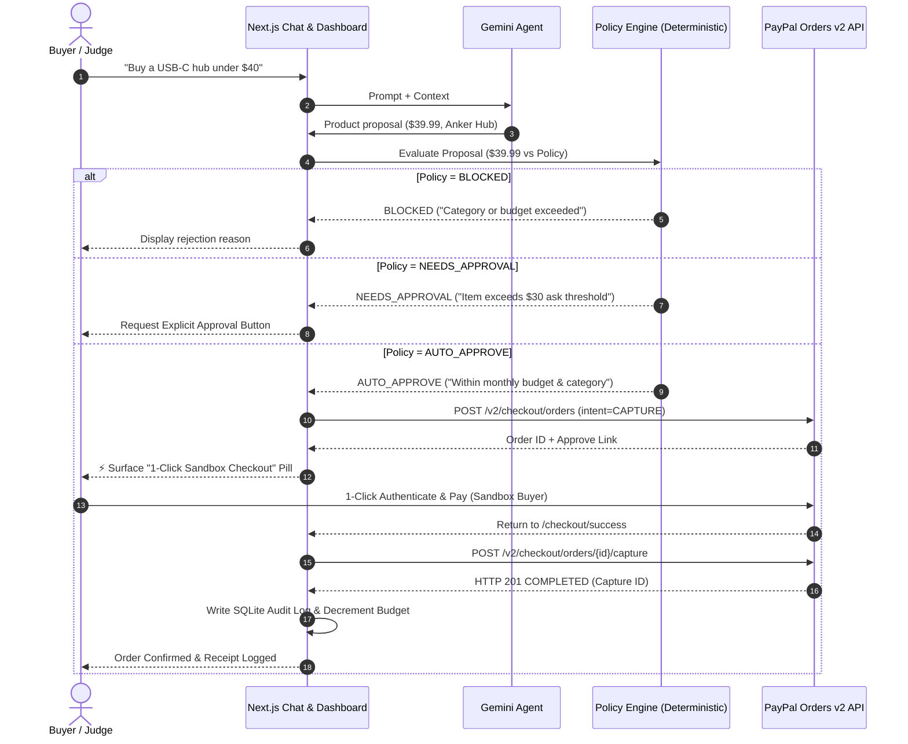

# SpendGuard Feasibility Study

> **Evaluation Date:** November 2026  
> **Target Event:** PayPal AI Hackathon (Devpost) — 5-Day Sprint  
> **Source Brief:** [`docs/PROJECT_BRIEF.md`](file:///Users/riteshgarg/Downloads/Paypal%20Hackathon/docs/PROJECT_BRIEF.md)  
> **Official Sources Referenced:**
> - [developer.paypal.com](https://developer.paypal.com)
> - [docs.paypal.ai](https://docs.paypal.ai)
> - [github.com/paypal/AI-Toolkit](https://github.com/paypal/AI-Toolkit)
> - [docs.trychannel3.com](https://docs.trychannel3.com)
> - [ai.google.dev](https://ai.google.dev)

---

## 1. PayPal Orders v2 in Sandbox

### Exact Server-Side Sequence (Create & Capture)
1. **OAuth 2.0 Access Token Generation:**
   - **Method & Endpoint:** `POST https://api-m.sandbox.paypal.com/v1/oauth2/token`
   - **Headers:**  
     `Authorization: Basic <base64(CLIENT_ID:CLIENT_SECRET)>`  
     `Content-Type: application/x-www-form-urlencoded`
   - **Body:** `grant_type=client_credentials`
   - **Response:** Access token with `expires_in` (typically 32400 seconds / 9 hours).

2. **Order Creation:**
   - **Method & Endpoint:** `POST https://api-m.sandbox.paypal.com/v2/checkout/orders`
   - **Headers:**  
     `Authorization: Bearer <ACCESS_TOKEN>`  
     `Content-Type: application/json`  
     `PayPal-Request-Id: <UUID>` *(Recommended for idempotency)*
   - **Payload:**
     ```json
     {
       "intent": "CAPTURE",
       "purchase_units": [
         {
           "reference_id": "spendguard_order_123",
           "description": "Anker USB-C Hub 7-in-1",
           "amount": {
             "currency_code": "USD",
             "value": "39.99"
           }
         }
       ],
       "application_context": {
         "brand_name": "SpendGuard",
         "return_url": "https://<app-domain>/checkout/success",
         "cancel_url": "https://<app-domain>/checkout/cancel",
         "user_action": "PAY_NOW"
       }
     }
     ```
   - **Response:** Returns `id` (e.g., `5O190127TN364715T`), `status: "CREATED"`, and HATEOAS `links[]` containing `rel: "approve"`.

3. **Buyer Approval Step:**
   - The buyer authenticates and approves the purchase via PayPal.

4. **Order Capture:**
   - **Method & Endpoint:** `POST https://api-m.sandbox.paypal.com/v2/checkout/orders/{order_id}/capture`
   - **Headers:**  
     `Authorization: Bearer <ACCESS_TOKEN>`  
     `Content-Type: application/json`  
     `PayPal-Request-Id: <UUID>`
   - **Payload:** `{}` *(Empty JSON object)*
   - **Response:** Returns `status: "COMPLETED"` with `purchase_units[0].payments.captures[0].id`.

### Buyer Approval: JS SDK vs. Redirect
- **Option A: In-Context Popup (PayPal JS SDK):**
  - Frontend loads the SDK. User clicks the PayPal Button $\rightarrow$ `createOrder` fetches order ID from Next.js server route $\rightarrow$ PayPal popup opens $\rightarrow$ User signs into sandbox buyer account and clicks "Pay" $\rightarrow$ `onApprove` calls `/api/orders/[id]/capture`.
- **Option B: Approve Link Redirect:**
  - Server calls `POST /v2/checkout/orders`, extracts `link.rel === "approve"`, and redirects the user or provides a 1-click link. Upon approval on PayPal's sandbox page, PayPal redirects the browser back to `return_url?token={order_id}&PayerID={payer_id}`, where a Next.js page/handler executes capture.
- **Simplest Approach for Next.js App Router:**
  - **Redirect Flow (`rel: "approve"`)** is the simplest and cleanest for server-driven Next.js App Router. It requires **zero** client-side external scripts, avoids React hydration mismatches, and works reliably with standard server actions and API routes.
  - If an inline popup modal is preferred, standard **JS SDK v5 via `@paypal/react-paypal-js`** is the standard React solution.

### JS SDK Status: v5 vs. v6
- **v5 (`https://www.paypal.com/sdk/js`):** Currently the **active, standard, production-ready SDK** with full documentation and standard React wrapper library (`@paypal/react-paypal-js`).
- **v6 Web SDK (`https://www.paypal.com/web-sdk/v6/core`):** PayPal's next-generation modular SDK. Requires dynamic server-side browser client tokens (`POST /v1/identity/generate-token`) and custom web components (`<paypal-button>`).
- **Recommendation for 5-Day Sprint:** Use **JS SDK v5** (or the server-side **Redirect link**), as v6 requires extra token-generation infrastructure and lacks mature community React bindings.

*Official Documentation:*
- [PayPal Orders v2 API Reference](https://developer.paypal.com/docs/api/orders/v2/)
- [PayPal Standard Checkout Integration Guide](https://developer.paypal.com/docs/checkout/standard/integrate/)
- [JavaScript SDK v6 Migration Guide](https://developer.paypal.com/docs/checkout/standard/integrate/upgrade/)

---

## 2. Vaulting & Saved Payment Methods (Without Per-Purchase Approval)

### Can a purchase be captured without buyer approving each time?
- **Technically in Production:** Yes. PayPal supports Customer-Not-Present / Merchant-Initiated Transactions via the **Vault** feature (`payment_source.vault.id` or `payment_source.paypal.vault_id`).
- **Is it usable in Sandbox for a 5-day project?** **NO.**
  - **Reason:** Saving a **PayPal Wallet** account to the Vault (as opposed to tokenizing raw credit cards) requires **Reference Transactions** and Vault permissions to be explicitly enabled on the sandbox merchant and buyer accounts by PayPal support. Attempting to vault PayPal accounts without account-level Reference Transaction approval results in `PAYMENT_SOURCE_CANNOT_BE_VAULTED` or `NOT_SUPPORTED` API errors.
  - Tokenizing raw debit/credit cards directly requires SAQ-A/SAQ-D PCI-DSS configurations and Hosted Fields setup, which adds unnecessary complexity and friction to a 5-day hackathon.
  - **Verdict:** Do **NOT** attempt fully headless card-on-file vaulting for a 5-day hackathon. The interactive buyer-approval step (sandbox login $\rightarrow$ 1-click Pay Now) is the officially supported, robust path.

*Official Documentation:*
- [PayPal Save Payment Methods Overview](https://developer.paypal.com/docs/checkout/save-payment-methods/)
- [Orders v2 Vault Instructions Reference](https://developer.paypal.com/docs/api/orders/v2/#orders_create!path=payment_source/paypal/vault&t=request)

---

## 3. Webhooks

### Events That Matter for SpendGuard
1. **`PAYMENT.CAPTURE.COMPLETED`**:
   - Triggers when an authorized payment order has been successfully captured.
   - **SpendGuard Action:** Confirm payment status, mark purchase `COMPLETED`, record final transaction timestamp and capture ID in SQLite audit log.
2. **`PAYMENT.CAPTURE.REFUNDED`**:
   - Triggers when a capture is partially or fully refunded.
   - **SpendGuard Action:** Reverse deducted amount from the monthly budget counter, mark status `REFUNDED` in audit log.
3. *(Optional)* **`CHECKOUT.ORDER.APPROVED`**:
   - Triggers when the buyer approves the order on PayPal before capture.

### Verifying Signatures Server-Side
Do not accept unverified webhooks. PayPal provides a dedicated verification endpoint:
- **Endpoint:** `POST https://api-m.sandbox.paypal.com/v1/notifications/verify-webhook-signature`
- **Request Headers from incoming webhook:**
  - `PAYPAL-AUTH-ALGO`
  - `PAYPAL-CERT-URL`
  - `PAYPAL-TRANSMISSION-ID`
  - `PAYPAL-TRANSMISSION-SIG`
  - `PAYPAL-TRANSMISSION-TIME`
- **Request Body sent to PayPal:**
  ```json
  {
    "auth_algo": "<PAYPAL-AUTH-ALGO>",
    "cert_url": "<PAYPAL-CERT-URL>",
    "transmission_id": "<PAYPAL-TRANSMISSION-ID>",
    "transmission_sig": "<PAYPAL-TRANSMISSION-SIG>",
    "transmission_time": "<PAYPAL-TRANSMISSION-TIME>",
    "webhook_id": "<CONFIGURED_WEBHOOK_ID>",
    "webhook_event": <RAW_PARSED_WEBHOOK_BODY>
  }
  ```
- **Response:** `{"verification_status": "SUCCESS"}` or `"FAILURE"`.

### Local and Render Testing
- **Local Testing:**
  - Use `ngrok http 3000` to expose the local Next.js server (`/api/webhooks/paypal`).
  - Configure the webhook endpoint in PayPal Developer Dashboard $\rightarrow$ Sandbox Apps $\rightarrow$ Add Webhook.
  - *Caution regarding Webhook Simulator:* PayPal's Developer Dashboard Webhook Simulator sends mock events whose signatures fail postback verification against `verify-webhook-signature`. For automated local testing, allow a development toggle or trigger real sandbox checkouts via ngrok.
- **Render Deployment Testing:**
  - Add your production URL (`https://<render-service-name>.onrender.com/api/webhooks/paypal`) to the Webhooks section of your Sandbox App in PayPal Developer Dashboard.
  - Subscribe to `PAYMENT.CAPTURE.COMPLETED` and `PAYMENT.CAPTURE.REFUNDED`.

*Official Documentation:*
- [PayPal Webhooks API Reference](https://developer.paypal.com/docs/api/webhooks/v1/)
- [Verify Webhook Signature API](https://developer.paypal.com/docs/api/webhooks/v1/#verify-webhook-signature_post)

---

## 4. Refunds

### Endpoint & Request Schema
- **Endpoint:** `POST https://api-m.sandbox.paypal.com/v2/payments/captures/{capture_id}/refund`
- **Headers:**  
  `Authorization: Bearer <ACCESS_TOKEN>`  
  `Content-Type: application/json`  
  `PayPal-Request-Id: <UUID>`
- **Payload:**
  - **Full Refund:** `{}` *(Empty JSON body)*
  - **Partial Refund:**
    ```json
    {
      "amount": {
        "value": "15.00",
        "currency_code": "USD"
      },
      "note_to_payer": "SpendGuard policy undo"
    }
    ```

### Sandbox Behavior
- Sandbox refunds execute synchronously and return `HTTP 201 Created` with `status: "COMPLETED"`, a unique refund `id`, and the refund `amount`.
- PayPal immediately fires the `PAYMENT.CAPTURE.REFUNDED` webhook.
- The `capture_id` is retrieved directly from the previous capture response: `purchase_units[0].payments.captures[0].id`.

*Official Documentation:*
- [PayPal Payments v2 Refund Capture Reference](https://developer.paypal.com/docs/api/payments/v2/#captures_refund)

---

## 5. PayPal Sandbox MCP Server & Agent Toolkit

### Available Tools
As defined in `github.com/paypal/AI-Toolkit` and `@paypal/mcp` (`docs.paypal.ai`):
- **Orders & Payments:** `create_order`, `capture_payment`, `create_refund`.
- **Invoicing:** `create_invoice`, `list_invoices`, `get_invoice`, `send_invoice`, `send_invoice_reminder`, `cancel_sent_invoice`, `generate_invoice_qr_code`.
- **Disputes:** `list_disputes`, `accept_dispute_claim`.
- **Shipping:** `create_shipment_tracking`, `get_shipment_tracking`.
- **Subscriptions:** `create_subscription_plan`, `create_subscription`, `cancel_subscription`.
- **Insights:** `list_transactions`, `get_merchant_insights`.

### Do they add anything over the direct REST API?
- **NO.** The MCP tools are simple JSON-RPC abstractions over the identical PayPal REST endpoints (`/v2/checkout/orders`, `/v2/payments/captures`, etc.).
- **Crucial Architectural Alignment:** Giving an LLM direct access to the PayPal MCP server would **violate the SpendGuard core principle**:  
  *"The LLM proposes, deterministic code decides."*  
  If the LLM had direct tool access to `create_order` or `capture_payment`, it would bypass the policy engine. The backend must orchestrate PayPal calls *only after* deterministic policy approval. Direct REST calls inside the Next.js backend are cleaner, safer, and fully testable.

*Official Documentation:*
- [PayPal AI-Toolkit Repository](https://github.com/paypal/AI-Toolkit)
- [PayPal AI Documentation](https://docs.paypal.ai)

---

## 6. Channel3 API

### Endpoint for Product Search
- **Endpoint:** `POST https://api.trychannel3.com/v1/search`
- **Headers:**  
  `Authorization: Bearer <CHANNEL3_API_KEY>`  
  `Content-Type: application/json`
- **Request Body:**
  ```json
  {
    "query": "USB-C hub multi-port"
  }
  ```

### Product Response Schema
The response contains a top-level `products` array. Crucially, **pricing and buy URLs reside inside the `offers` array** (as multiple merchants sell the same item):
```json
{
  "products": [
    {
      "id": "prod_abc123",
      "title": "Anker 555 USB-C Hub (8-in-1)",
      "description": "High-speed data transfer and 100W power delivery",
      "brands": [
        {
          "id": "brand_anker",
          "name": "Anker"
        }
      ],
      "images": [
        {
          "url": "https://img.cdn.channel3.ai/anker.jpg",
          "cleaned_url": "https://img.cdn.channel3.ai/anker_clean.png",
          "is_main_image": true
        }
      ],
      "offers": [
        {
          "domain": "amazon.com",
          "price": {
            "amount": 39.99,
            "currency": "USD"
          },
          "availability": "InStock",
          "condition": "new",
          "url": "https://trychannel3.com/redirect?to=amazon..."
        }
      ]
    }
  ]
}
```

### Rate Limits & Credits
- **Rate Limits (Default Tier):**
  - Search (`POST /v1/search`): **10 requests/second**.
  - URL Lookup (`POST /v1/lookup`): **5 requests/second**.
  - Daily Quota: **10,000 requests/day**.
  - Exceeded Status: `HTTP 429 Too Many Requests` with `Retry-After: 5` header.
- **Credit Consumption:**
  - Free Tier: **1,000 free credits/month**.
  - Extra usage: **$0.007 per credit**.
  - **[UNVERIFIED]**: The exact credit deduction ratio per single `POST /v1/search` request (e.g., whether 1 search = 1 credit or varies by result count) is not explicitly itemized in the public documentation page; usage must be monitored on the Channel3 user dashboard.
  - *Risk Mitigation:* Implement local caching and a fallback mock product catalog so development does not exhaust the 1,000 credit allotment.

*Official Documentation:*
- [Channel3 Documentation](https://docs.trychannel3.com)
- [Channel3 Search Mode Reference](https://docs.trychannel3.com/search-modes/search)
- [Channel3 Rate Limits](https://docs.trychannel3.com/faq/rate-limits)
- [Channel3 Billing and Credits](https://docs.trychannel3.com/faq/billing-and-credits)

---

## 7. Gemini Function Calling & Structured Output

### Minimal Pattern A: Structured Output for Rule Parsing
Enforces a strict JSON Schema when translating natural language spending constraints into a deterministic policy object.

```typescript
import { GoogleGenAI, Type } from "@google/genai";

const ai = new GoogleGenAI({ apiKey: process.env.GEMINI_API_KEY });

const policySchema = {
  type: Type.OBJECT,
  properties: {
    maxMonthlyBudget: { type: Type.NUMBER, description: "Monthly budget ceiling in USD" },
    allowedCategories: { 
      type: Type.ARRAY, 
      items: { type: Type.STRING },
      description: "Allowed product categories, e.g. electronics, books"
    },
    requireApprovalAbove: { 
      type: Type.NUMBER, 
      description: "Transaction amount above which human approval is mandatory" 
    },
    blockedMerchants: {
      type: Type.ARRAY,
      items: { type: Type.STRING },
      description: "Disallowed merchant domains or brand names"
    }
  },
  required: ["maxMonthlyBudget", "allowedCategories", "requireApprovalAbove"]
};

export async function parseSpendingRules(prompt: string) {
  const response = await ai.models.generateContent({
    model: "gemini-2.5-flash",
    contents: `Parse these user spending rules into structured policy JSON:\n"${prompt}"`,
    config: {
      responseMimeType: "application/json",
      responseSchema: policySchema
    }
  });

  return JSON.parse(response.text.trim());
}
```

### Minimal Pattern B: Agent Loop with Tools
The shopping agent queries Channel3 products via tool calling, but **never** accesses payment execution tools.

```typescript
import { GoogleGenAI, FunctionDeclaration, Type } from "@google/genai";

const searchTool: FunctionDeclaration = {
  name: "searchProducts",
  description: "Search live products by query and maximum budget",
  parameters: {
    type: Type.OBJECT,
    properties: {
      query: { type: Type.STRING, description: "Item description, e.g. USB-C hub" },
      maxPrice: { type: Type.NUMBER, description: "Optional max price filter" }
    },
    required: ["query"]
  }
};

export async function runShoppingAgent(userPrompt: string, history: any[] = []) {
  const ai = new GoogleGenAI({ apiKey: process.env.GEMINI_API_KEY });

  // 1. Initial invocation with tools
  const response = await ai.models.generateContent({
    model: "gemini-2.5-flash",
    contents: [...history, { role: "user", parts: [{ text: userPrompt }] }],
    config: {
      tools: [{ functionDeclarations: [searchTool] }]
    }
  });

  const functionCalls = response.functionCalls();
  if (functionCalls && functionCalls.length > 0) {
    const call = functionCalls[0];
    if (call.name === "searchProducts") {
      // 2. Deterministic backend executes tool
      const searchResults = await executeChannel3Search(call.args as any);

      // 3. Return tool output back to Gemini
      const secondTurn = await ai.models.generateContent({
        model: "gemini-2.5-flash",
        contents: [
          ...history,
          { role: "user", parts: [{ text: userPrompt }] },
          { role: "model", parts: [{ functionCall: call }] },
          {
            role: "tool",
            parts: [{
              functionResponse: {
                name: "searchProducts",
                response: { results: searchResults }
              }
            }]
          }
        ]
      });

      return {
        message: secondTurn.text,
        candidateProduct: searchResults[0] // Candidate proposed for policy engine evaluation
      };
    }
  }

  return { message: response.text, candidateProduct: null };
}
```

*Official Documentation:*
- [Gemini API Structured Outputs](https://ai.google.dev/gemini-api/docs/structured-output)
- [Gemini API Function Calling](https://ai.google.dev/gemini-api/docs/function-calling)

---

## Feasibility Verdict & Risk Analysis

### Final Verdict: **GO**
The project scope defined in [`docs/PROJECT_BRIEF.md`](file:///Users/riteshgarg/Downloads/Paypal%20Hackathon/docs/PROJECT_BRIEF.md) is technically feasible within a 5-day hackathon window. Every required capability (Gemini structured outputs + tool calling, PayPal Orders v2 REST sandbox, Channel3 API, SQLite persistence, and Render deployment) is fully supported by production APIs.

### Ranked Risks & Mitigations

| Severity | Risk | Impact | Mitigation Strategy |
| :--- | :--- | :--- | :--- |
| **HIGH** | **Autonomous Checkout Misconception** | Attempting headless payments without buyer approval via PayPal Vault in sandbox leads to Reference Transaction rejection errors (`PAYMENT_SOURCE_CANNOT_BE_VAULTED`). | Standardize on **1-Click Agent Approval**: for `AUTO_APPROVE` orders, the agent creates the PayPal Order immediately and surfaces a 1-click sandbox approval link/modal. Code decision is autonomous; buyer confirmation is 1-click. |
| **MEDIUM** | **Channel3 Credit Exhaustion / Outage** | Exhausting the 1,000 monthly free tier credits or running into API downtime blocks testing and judge evaluation. | Implement a **Mock Product Catalog fallback** that automatically kicks in if `CHANNEL3_API_KEY` is missing or returns errors. |
| **MEDIUM** | **Render Ephemeral SQLite Disk** | Render free tier web service dynos wipe local SQLite files whenever the service sleeps or redeploys, losing budget state. | Use a lightweight schema initialization script that automatically seeds default policies and recent transactions if the database is blank on container startup. |
| **LOW** | **Webhook Simulator Postback Rejection** | PayPal Dashboard Webhook Simulator notifications fail signature verification when tested against `verify-webhook-signature`. | Use actual sandbox checkouts forwarded via `ngrok` for testing, and add an environment check to allow unsigned webhooks strictly when `NODE_ENV === "test"`. |

---

## Fallback Design: Autonomous Checkout with PayPal Sandbox

If the user or hackathon judges expect "autonomous AI spending" without requiring a human to manually go through a multi-page checkout:



### 1-Click Sandbox Pre-Authorization Flow:
1. When the policy engine outputs `AUTO_APPROVE`, the backend creates the order in PayPal sandbox immediately with `intent: "CAPTURE"`.
2. The agent chat UI displays an **"Autonomous Authorization Ready"** pill with product details, budget impact, and a highlighted **"Authorize via PayPal Sandbox"** button.
3. The judge clicks the button once, sandbox credentials auto-fill (or 1-click in the popup), and the backend captures the funds, logs the audit record, and updates the dashboard in real time.
4. For automated testing or offline judge evaluation without sandbox credentials, provide a clearly documented `DEMO_MODE=mock_paypal` toggle that simulates the capture and webhook lifecycle end-to-end.
